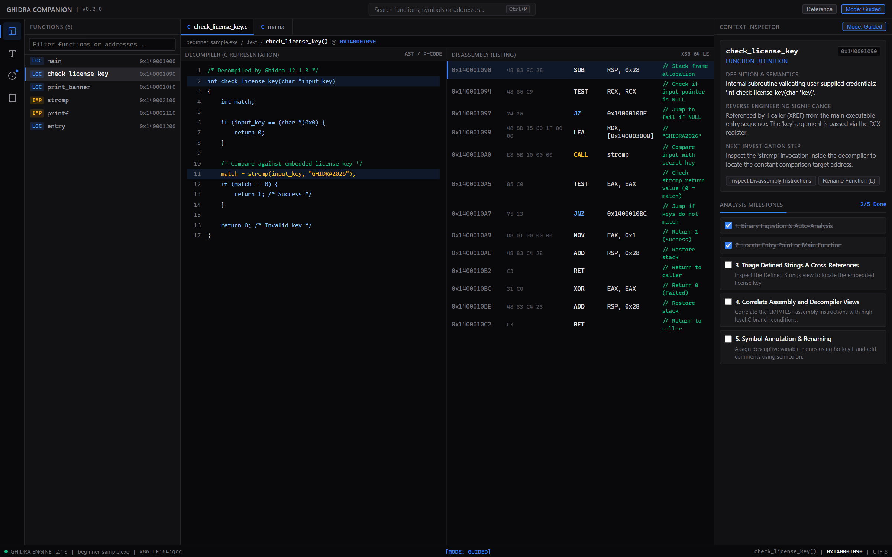
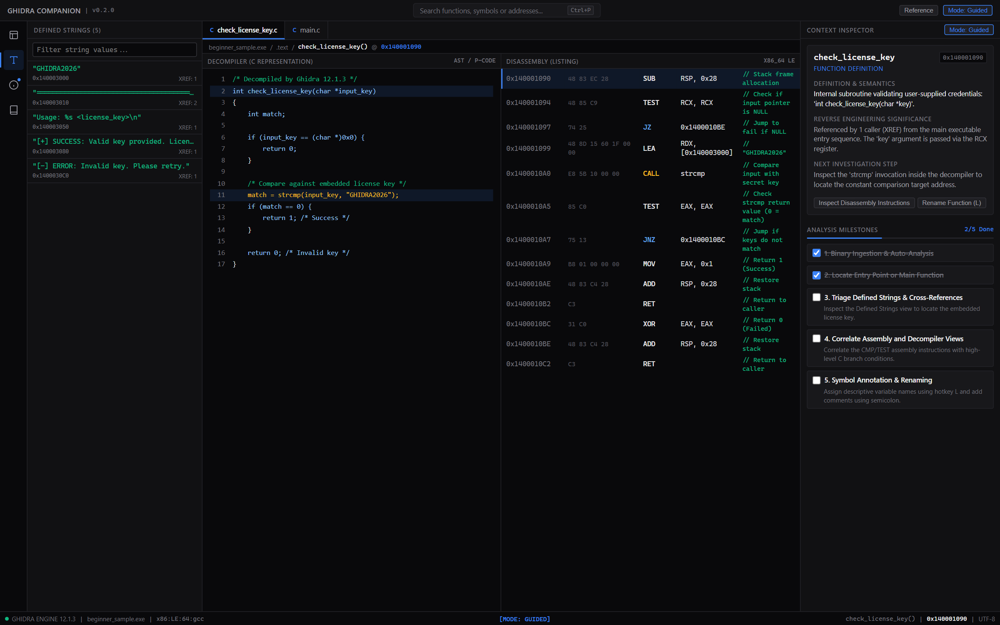
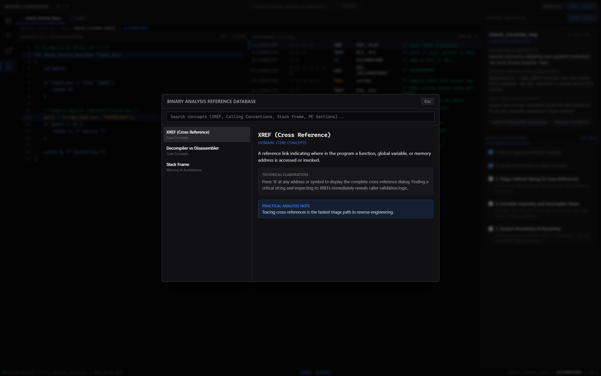

# Ghidra Buddy

A learning companion extension for [Ghidra](https://ghidra-sre.org/) aimed at people opening it for the first time.

Ghidra can be intimidating: many windows, many shortcuts, unfamiliar symbols. Ghidra Buddy adds a side panel that, for whatever is under your cursor, tells you:

1. What it is (function header, API call, stack variable, string, branch).
2. Why it matters (for example, a password check or a control-flow decision).
3. What to look at next, with one-click navigation.

It runs entirely locally. No cloud or AI services are used; explanations come from deterministic rules inside the extension.

## Screenshots

The desktop frontend (`desktop/`) shows the same guidance next to the decompiler and disassembly views. The screenshots below use the built-in demo data for `samples/beginner_sample`.







## Features

- **Context Inspector**: updates as you move through the Listing or Decompiler. Covers functions (signature, parameters, calling convention, xrefs), external API calls, conditional jumps, stack variables and defined strings.
- **Guided Workflow**: a five-step checklist for a first analysis: load and analyze, find the entry point, review strings and xrefs, compare assembly with decompiler output, rename symbols.
- **Offline glossary**: searchable reverse-engineering terms (xref, stack frame, calling conventions, PE/ELF sections, IAT, endianness, CFG and more).
- **Guided / Full mode**: toggles between a streamlined panel and the full workspace. It only changes the UI and never touches the program database.
- **Local bridge** (optional): a JSON API on `127.0.0.1:19842` used by the desktop frontend in `desktop/`.

## Requirements

- Ghidra 12.1.3 or later
- JDK 21

## Installation

1. Build the extension (see below) or download the `.zip` from the Releases page.
2. In Ghidra, choose **File > Install Extensions...**, click **+**, and select the `.zip`.
3. Enable the extension, click OK, and restart Ghidra.
4. Open a program in the CodeBrowser. The **Learning Assistant** panel appears on the right; if not, open it from the **Window** menu.

## Building

Set `GHIDRA_INSTALL_DIR` to your Ghidra installation, then use the Gradle wrapper.

```powershell
$env:GHIDRA_INSTALL_DIR = "C:\ghidra_12.1.3_PUBLIC"
.\gradlew.bat test
.\gradlew.bat buildExtension
```

The extension zip is written to `dist/`.

## Sample program

`samples/beginner_sample/main.c` is a small license-check program for practice. Compile it yourself (for example `gcc main.c -o beginner_sample.exe`) and import it into Ghidra.

## Bridge and desktop frontend

The extension starts a local HTTP bridge on `127.0.0.1:19842`. Change the port with `-Dghidracompanion.port=<port>`. The bridge only accepts requests addressed to loopback and from allowed origins (`localhost:5173` and Tauri); there is no token authentication.

`desktop/` contains an optional React/Tauri frontend that talks to the bridge and falls back to demo data when Ghidra is not running.

## Project layout

```text
src/main/java/ghidracompanion/
  GhidraCompanionPlugin.java   plugin lifecycle and program events
  bridge/                      local HTTP/JSON bridge
  model/                       context, glossary and walkthrough models
  service/                     analysis rules, glossary, walkthrough, mode manager
  ui/                          Swing panel and dockable provider
src/test/java/                 JUnit 5 tests
desktop/                       optional React/Tauri frontend
samples/                       practice program
docs/                          architecture and user guide
```

## Status

Beta. Unit tests pass, but the extension has had limited testing inside Ghidra itself. Issues and pull requests are welcome.

## License

Apache License 2.0. See [LICENSE](LICENSE) and [NOTICE](NOTICE).

Ghidra is developed by the National Security Agency. This project is independent and is not affiliated with or endorsed by the NSA or the Ghidra project.
