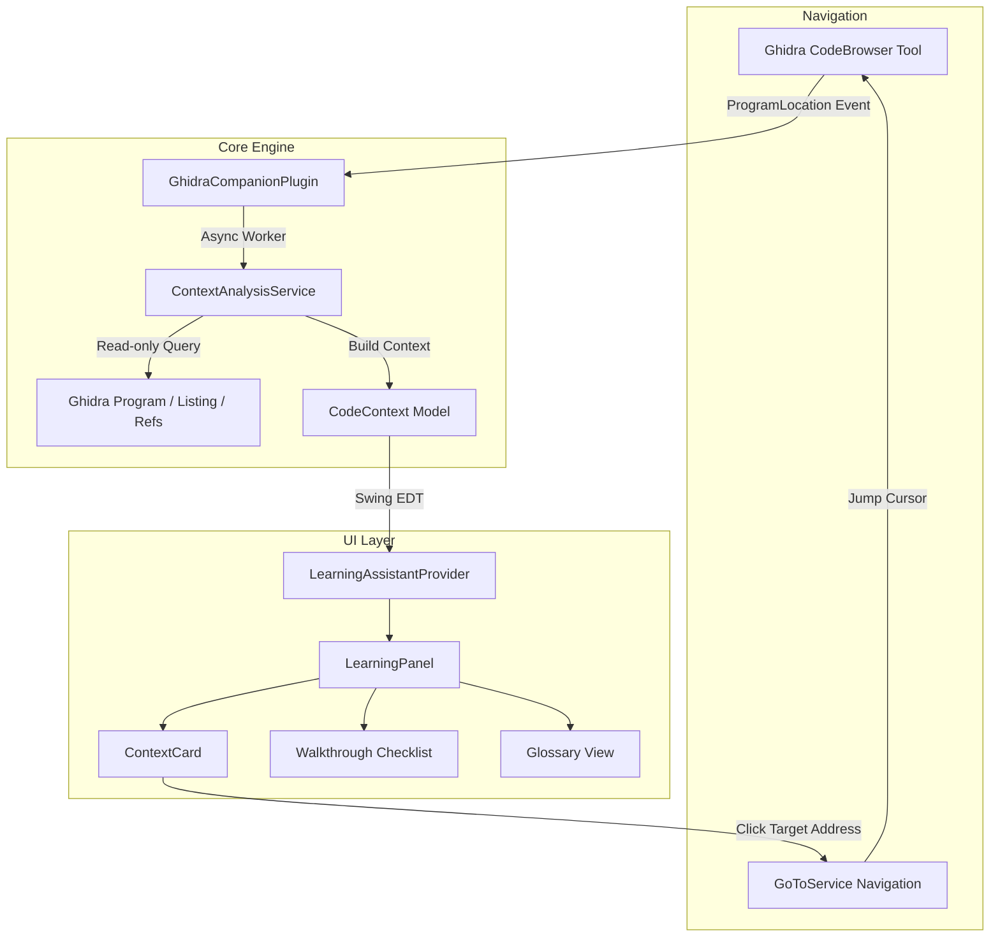

# Ghidra Companion - Mimari ve Tasarım Dokümanı

Bu doküman, **Ghidra Companion** eklentisinin dahili yazılım mimarisini, veri akışını, bileşen ayrımını ve performans/güvenlik prensiplerini detaylandırır.

---

## 1. Mimari Prensipler

1. **Deterministik ve Çevrimdışı (Offline-First):** Eklenti, hiçbir dış yapay zeka servisine veya bulut API'sine bağımlı değildir. Tüm açıklamalar Ghidra'nın gerçek `Program`, `FunctionManager`, `ReferenceManager` ve AST modelleri üzerinden deterministik kurallarla üretilir.
2. **Kullanıcı İradesini Koruma:** Eklenti bir ikili dosyanın ne olduğuna kullanıcı adına karar vermez; kullanıcıya gördüğü komut veya fonksiyonun ne anlama geldiğini açıklar ve rehberlik eder.
3. **Sıfır Veri Kaybı (Non-destructive Mode Switching):** Mod değiştirme işlemi (Beginner / Advanced) yalnızca Ghidra Docking UI katmanında (`ComponentProvider`) çalışır. Ghidra'nın Object Database (`.gpr` / `.rep`) işlemlerine ve Undo/Redo yığınına kesinlikle müdahale edilmez.
4. **EDT Duyarlılığı (Event Dispatch Thread Safety):** Kullanıcı büyük bir ikili dosyada hızlıca gezinirken arayüzün kilitlenmemesi için tüm bağlam analizi arka plandaki `ExecutorService` iş parçacığında çalıştırılır ve sonuçlar `SwingUtilities.invokeLater()` ile UI'a aktarılır.

---

## 2. Bileşenler ve Sorumluluklar

### `GhidraCompanionPlugin`
- `ProgramPlugin` sınıfından türer.
- Ghidra'nın `locationChanged`, `programActivated` ve `programDeactivated` olaylarını yakalar.
- Olayları kuyruğa alarak arka plan analiz motoruna yönlendirir.

### `ContextAnalysisService`
- Programın etkin konumundaki nesneyi sınıflandırır:
  - `VariableLocation` -> Yığın ofseti, veri tipi ve rolü.
  - `Data` -> Sabit metin dizeleri, karakter kodlaması ve XREF sayısı.
  - `Instruction` -> Komut mnemonik analizi (`CALL`, `JZ`/`JNZ`, `CMP`/`TEST`, `SUB RSP`).
  - `Function` -> Başlık, imza, çağrı kuralı ve referanslar.
- Çıktı olarak `CodeContext` nesnesi döndürür.

### `WorkspaceManager`
- `BEGINNER` ve `ADVANCED` mod durumlarını yönetir.
- Docking bileşenlerinin görünürlüğünü ve önceliğini ayarlar.

### `GlossaryService` & `WalkthroughService`
- Çevrimdışı, zengin terimler sözlüğü ve 5 adımlı başlangıç kontrol listesi sağlar.

---

## 3. Güvenlik ve Uyumluluk

* **Java Modül Uyumluluğu:** Java 21 modül kısıtlamalarını aşmak için gayriresmi reflection kullanılmaz. Yalnızca Ghidra'nın onaylı public API'leri kullanılır.
* **Lisans Uyumluluğu:** Ghidra'nın Apache-2.0 lisansına ve NOTICE koşullarına tam uyum sağlanır.
